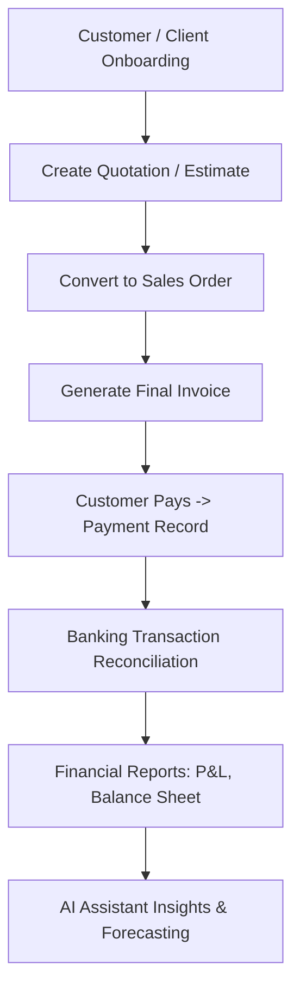

# 06 - End-to-End ERP Business Workflow & Case Study

## 📌 1. ERP Business Life Cycle (Accounting Workflow)

Meridian ERP sirf ek static page nahi hai, balki yeh real enterprise accounting lifecycle ko model karta hai:

---

## 🔄 2. Step-by-Step Workflow Walkthrough

### Step 1: Customer Onboarding (`src/views/Customers.tsx`)
- **Action:** Naya client *"Acme Corporation"* register kiya jata hai.
- **Data Captured:** Name, Email, Credit Limit ($50,000), Payment Terms (Net 30).
- **Code:** `useCustomers()` hook call hota hai aur customer list update ho jati hai.

### Step 2: Estimate to Sales Order (`src/views/Estimates.tsx` & `SalesOrders.tsx`)
- **Action:** Acme Corp ko $15,000 ka web development estimate send kiya jata hai.
- **Conversion:** Jaise hi client accept karta hai, system 1-click mein Estimate ko **Sales Order** mein convert kar deta hai.

### Step 3: Invoice Generation (`src/views/Invoices.tsx`)
- **Action:** Order deliver hone par Invoice generate hota hai (`INV-2024-0849`).
- **Calculation:** Subtotal ($15,000) + Tax 10% ($1,500) = **Total $16,500**.
- **Status:** Badge shows `"Pending"`.

### Step 4: Payment Received (`src/views/Payments.tsx` & `Banking.tsx`)
- **Action:** Acme Corp ne $16,500 Stripe / Bank transfer ke zariye pay kiye.
- **Reconciliation:** Banking module bank statement feed se transaction match karta hai aur status `"Reconciled"` mark karta hai.
- **Invoice Status:** Automatically switches from `"Pending"` to `"Paid"`.

### Step 5: Financial Analytics & AI Assistant (`src/views/AIAssistant.tsx`)
- **Action:** Business owner AI Assistant se poochta hai:
  > *"Which clients have unpaid invoices over 30 days?"*
- **AI Processing:** Assistant invoices data filter karke directly response deta hai:
  > *"Acme Corp is fully paid, but Beta LLC has an overdue invoice of $4,200 due on Aug 15."*

---

## 💡 3. Quick Reference Architecture Summary

| Component Type | File Location | Responsibility |
|----------------|---------------|----------------|
| **Routing** | `src/app/(dashboard)/[module]/page.tsx` | Next.js Page URL entrypoint |
| **Presentation (View)** | `src/views/[Module].tsx` | Page UI, Modals, Forms, Layout |
| **Domain Logic (Hooks)** | `src/hooks/use[Module].ts` | Reactive state, loading, error handling |
| **API Services** | `src/services/[module]Service.ts` | Data layer, mock data / HTTP fetch |
| **Type Safety** | `src/types/index.ts` | TypeScript interfaces & contracts |
| **Design System** | `src/components/ui.tsx` | Reusable cards, tables, modals, buttons |

---

## 🎓 4. Summary & Next Steps

Aapne is ERP project ke tamam fundamental aur advanced concepts seekh liye hain:
1. **Next.js App Router** ke Route Groups aur Nested Layouts
2. **TypeScript** ke strong typing aur financial contracts
3. **Clean Architecture** (View -> Hook -> Service -> API Client)
4. **Tailwind CSS + CSS Variables** for responsive Dark/Light themes
5. **Recharts** for real-time financial dashboards
6. **Real-world Enterprise Workflows**

Is knowledge ke sath aap kisi bhi module ko expand kar sakte hain ya real backend API ke sath connect kar sakte hain!
